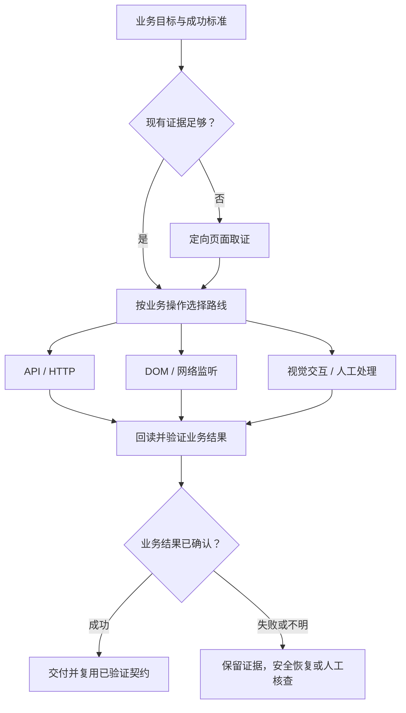

# Web Automation Development · 网页自动化开发指南

> 面向 Coding Agent 的跨工具网页自动化工程指南：**按需探索、按操作选路线、验证真实业务结果、安全恢复异常。**

`web-automation-development` 帮助 Agent 开发和维护可靠的网页自动化：决定哪些页面证据值得补采、每个业务操作适合 API、DOM 还是视觉交互、如何证明结果真正生效，以及出现异常后如何安全恢复。它不绑定特定浏览器或运行框架。

## 工作方式

路线按**操作**选择，不要求整站采用同一种工具。探索只补当前必要证据；提交结果不明时先核对远端状态，不能直接重试或切换执行器补写。

## 核心特点

- **操作级技术选型**：根据业务语义、授权、规模与维护成本，为不同步骤选择 API、HTTP 解析、DOM、网络响应监听或视觉交互；有证据才切换路线。
- **最小充分页面取证**：记录身份、作用域、定位与状态契约；已有可靠证据时复用，只补影响实现的缺口。
- **业务结果可靠性**：区分页面就绪与业务就绪、操作受理与最终生效；写入结果未知时先回读，不盲目重试或换执行器补写。
- **长期运行与复用**：明确分页/增量完成条件、检查点与会话归属；将稳定操作按需沉淀为可维护的能力，不强制生成新 Skill。

适合数据采集器、后台业务流程和已有自动化的契约变化或路线评估。临时截图、单次点击等操作直接使用相应工具。小修复可复用已有证据，无需重新探索。

## 安装与使用

将 [Skill 目录](skills/web-automation-development) 完整复制到支持 Agent Skills 的客户端所识别的项目或个人 Skills 目录。Codex 项目可使用 `.agents/skills/web-automation-development/`；以客户端文档为准。不要只复制 `SKILL.md`，因为它链接按需参考。

示例：使用 `$web-automation-development` 开发公开目录采集器。已有获准使用的官方列表接口，先核对字段、分页终点和最小样本；详情若未覆盖，再评估网页读取。

更多[合成场景](examples/scenarios.md)可用于验证和回归。没有必装的浏览器或 SDK。可复用项目已有的 Playwright、Playwright CLI、agent-browser、Chrome DevTools、DrissionPage、授权 RPA、官方 SDK 或 HTTP 客户端。工具能力、参数和权限以实际环境及官方资料为准。

探索默认只读。观察到网络请求不等于获准直接调用；写入超时应先回读业务状态。不要将凭据、会话状态或原始取证记录放入可公开的契约。

## 验证状态

- **已完成**：8 个合成场景的离线决策检查；2026-11-17 在 Playwright TodoMVC 和 Sauce Labs The Internet 上进行了 8 项单次页面终态冒烟检查，所选页面行为均得到预期结果。具体操作和异常见[第一轮在线验证记录](evaluation/online-smoke-2026-11-17.md)。
- **尚未完成**：独立的 Skill 自动触发验证、无 Skill/有 Skill 对照实验、Token/成本量化、API/UI 混合路线及服务端写入异常恢复的实际验证。

**不要将 8/8 页面检查理解为 Skill 的任务成功率或提效证据。** 这份 Skill 目前是 `v0.1.0` 初始公开版的工程指南，不提供通用运行时，也不保证任何目标站点可用。第三方项目只用于研究方法和已有测试页面，未分发其代码、Skill 文本或命令脚本。见[研究与致谢](REFERENCES.md)。

本项目采用 [MIT License](LICENSE) 开源。Copyright (c) 2026 Will。

**English:** An open-source Agent Skill for reliable web automation development, web scraping, and back-office workflows. It guides coding agents (including Codex) through evidence-driven site exploration, per-operation API/DOM/visual execution routing, page contracts, business-outcome verification, and safe recovery from uncertain writes. Tool-agnostic and designed for minimal, reusable investigation.
