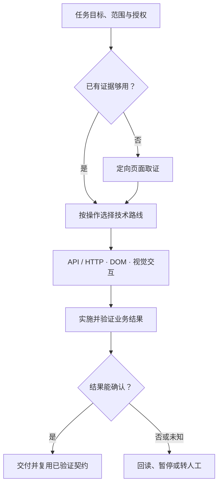

# Web Automation Development · 网页自动化开发指南

> **一个面向 Coding Agent 的网页自动化开发 Skill：让自动化不仅能操作页面，还能确认业务结果，并在异常时安全恢复。**

`web-automation-development` 是一份可复用的开发指导，不是浏览器、爬虫运行时或新的自动化框架。它帮助 Agent 在开发、维护网页自动化项目时判断：需要查看哪些页面证据、每个操作适合什么技术路线、怎样确定任务真正完成，以及结果不明时如何处理。

适用于使用 Codex 等 Coding Agent 开发数据采集器、企业后台流程和已有浏览器脚本的场景。**无需替换现有 Playwright、agent-browser、浏览器工具或 HTTP 客户端。**

## 什么时候值得使用？

| 你的任务 | 这份 Skill 重点指导什么 |
| --- | --- |
| 新建网页采集器 | 核对字段语义、分页终点与合法缺失；只探索实现所需页面 |
| 自动化后台操作 | 确认账号/租户/目标记录，按步骤选择 UI 或获准的 API，并回读结果 |
| 修复失效的浏览器流程 | 复用旧证据，定位页面变化或等待条件失效，只补必要取证 |
| 长时间批量运行 | 定义检查点、去重与停止条件，区分完成、部分完成和阻塞 |

临时截图、单次点击、纯粹解释浏览器概念，通常不需要加载完整开发 Skill。

## 它如何指导 Agent？



四条原则：

- **按操作选路线**：一个流程可以混合获准的 API、页面 DOM 和视觉交互；不为整站固定一种执行器。
- **按需取证**：已有可信页面契约时直接复用，只有状态变化、证据失效或关键未知时补采。
- **验证业务结果**：页面加载、按钮点击、成功提示，都不能单独替代业务状态确认。
- **安全处理未知写入**：提交超时或连接断开时先回读远端，不盲目重试，也不切换工具重复提交。

## 安装与开始使用

1. 下载或克隆本仓库。
2. 将 [skills/web-automation-development](skills/web-automation-development) **整个目录**复制到客户端支持的 Skills 位置。例如，Codex 项目可放在 `.agents/skills/web-automation-development/`；其他客户端按各自 Agent Skills 机制安装。
3. 在开发任务中引用 `$web-automation-development`，或让支持自动选择 Skills 的客户端根据任务决定是否加载。

可以直接向 Agent 提出这些任务：

```text
使用 $web-automation-development，为一个允许采集的公开目录网站开发增量采集器。
先确认字段、分页结束条件和已有可复用接口，再实现最小闭环并验证实际输出。
```

```text
使用 $web-automation-development，修复现有 Playwright 自动化中失效的列表定位。
优先复用现有证据，只补必要页面取证，验证修复后的目标记录与完成状态。
```

```text
使用 $web-automation-development，设计一个已授权的后台批量更新流程。
按操作评估 API/UI 路线；保存结果未知时必须先查询业务状态，再决定后续动作。
```

Skill 本身**没有必装依赖**，也不会替你安装或启动浏览器。项目可以继续使用现有的 Playwright、Playwright CLI、agent-browser、DrissionPage、官方 SDK、HTTP 客户端或其他已授权工具。具体工具能力、权限和版本以运行环境为准。

## 适用边界

- 本 Skill 不提供通用执行器、站点适配器或现成采集数据；它指导 Agent 如何开发与验证这些能力。
- 页面请求可被观察，不代表允许直接重放非公开接口。遵守目标网站的授权范围、使用条款及适用规则。
- 不绕过登录、验证码或风控限制；发现身份或结果无法可靠确认时应暂停或交给人工。
- 不承诺任何网站的自动化一定成功。复杂业务和写入流程必须在实际环境中验证，敏感凭据与浏览器 Profile 不应提交到公开仓库。

## 文档与项目状态

- [SKILL.md](skills/web-automation-development/SKILL.md)：核心决策流程及何时读取参考。
- [页面契约](skills/web-automation-development/references/page-contract.md)：复杂页面的定位、身份、状态及回读证据。
- [路线探索](skills/web-automation-development/references/route-exploration.md)：API、DOM、视觉路线选择与切换依据。
- [研究与致谢](REFERENCES.md)：借鉴的上游项目与许可证来源。

当前公开版本为 [v0.1.0](https://github.com/mingqiangdu1-arch/web-automation-development/releases/tag/v0.1.0)，采用 [MIT License](LICENSE)。在上游公开演示网站上，已有代码生成与独立浏览器回放的验证记录；这些结果**尚不能证明使用 Skill 比不使用更高效或更成功**。自动触发、Agent 自主页面探索、复杂 API/UI 路线和未知写入恢复仍需要真实项目验证。详细记录保留在 [evaluation/](evaluation/) 供开发者审阅，不作为使用门槛。

欢迎通过 [GitHub Issues](https://github.com/mingqiangdu1-arch/web-automation-development/issues) 反馈真实自动化开发场景、失效步骤和脱敏证据。请勿提交 Cookie、令牌、客户数据或私人页面截图。

Copyright (c) 2026 Will.

**English:** A tool-agnostic Agent Skill for developing and maintaining reliable web automation workflows. It guides coding agents through targeted site exploration, per-operation API/DOM/visual routing, business-outcome verification, and safe recovery from uncertain writes. It is an instruction layer—not a browser engine, scraper runtime, or authorization bypass.
